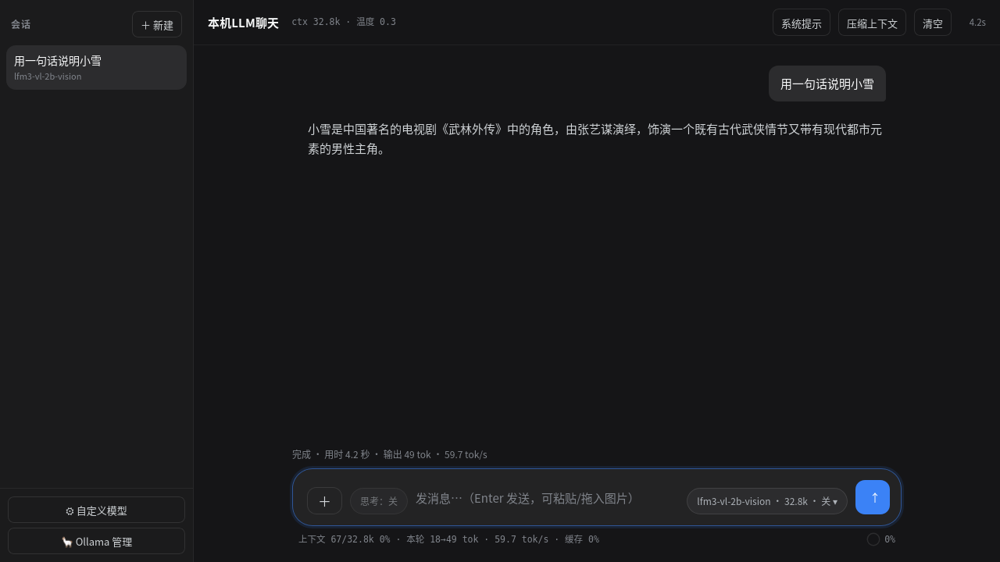
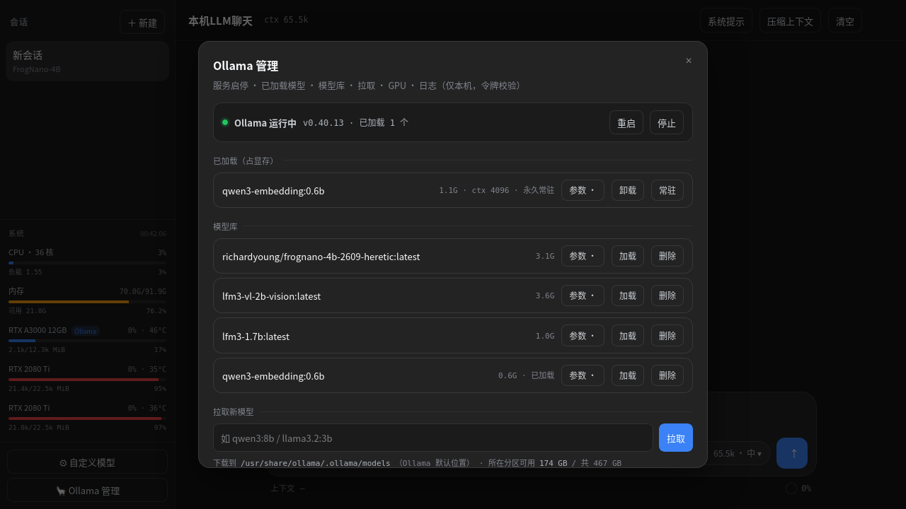
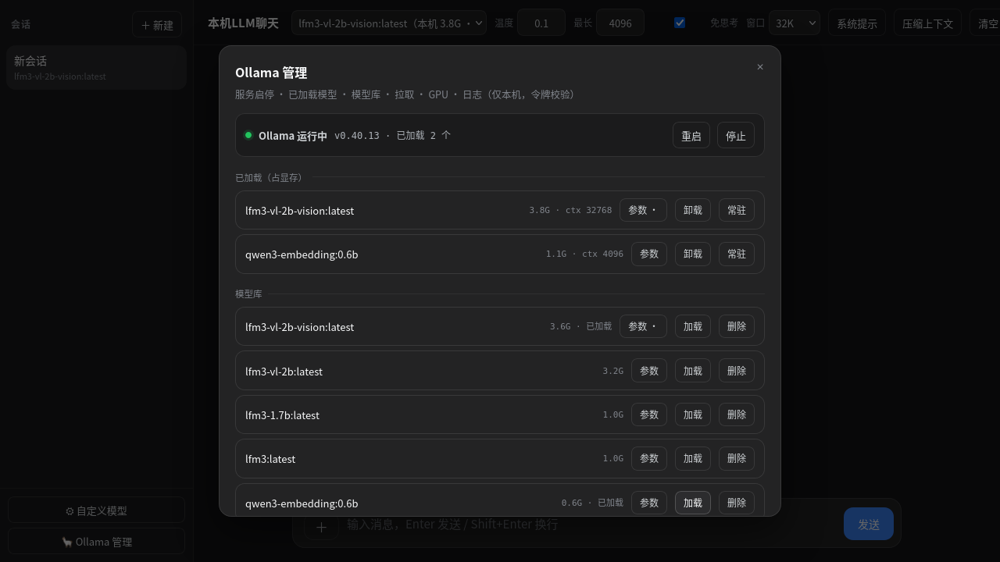

[English](README.en.md) · **中文**

# llmchat · 轻量本地 LLM 聊天 + Ollama 管理面板

**一个单文件前端 + 一个单文件后端（零第三方 Python 依赖），把「聊天」和「Ollama 运维」放进同一个页面。**

> 现有方案的空位：Open WebUI 是优秀的聊天门户，但管不了 Ollama 服务的启停、也没有「每模型启动参数」；GPUStack 管的是它自己部署的推理实例。llmchat 补的正是这块：**服务启停 + 每模型启动参数 + 显存可视 + 聊天/图片输入**，全部在 127.0.0.1 上一个页面里。

## 功能

### 聊天
- 多会话管理（新建 / 切换 / 删除）、会话内容本地持久化（localStorage）
- Markdown + 表格 + 代码高亮 + KaTeX 公式渲染，流式输出
- 思考过程（reasoning）折叠展示，可一键「免思考」（`think:false`）
- 系统提示按会话保存；「压缩上下文」把早先对话压成摘要
- 上下文占用条（按模型**实际加载**的窗口算百分比）

### 图片（多模态）
- 点输入框左侧 **＋** / 直接拖入 / `Ctrl+V` 粘贴
- 自动压缩：**发送给模型 1024px**（实测再小 OCR 就出错），**历史只存 256px 缩略图**（省 85% 存储）
- 支持一次多张

### Ollama 管理
- 服务状态与 **启动 / 停止 / 重启**（可选，需 sudoers 白名单）
- 已加载模型：显存占用、实际上下文、**卸载 / 常驻**
- 模型库：**加载 / 删除**
- **拉取新模型**（流式进度条）
- GPU 显存条（多卡分别显示占用/利用率/温度）
- Ollama 日志尾部 40 行

### 每模型启动参数
`num_ctx` `num_gpu` `num_batch` `num_thread` `temperature` `top_p` `top_k` `repeat_penalty` `num_predict` `keep_alive` + 任意高级参数（逗号分隔，如 `low_vram=1,use_mmap=0`）。

- 参数保存在服务端 `model-params.json`，换浏览器/清缓存不丢
- 点「加载」时按保存的参数拉起；**若模型已在显存里，会先卸载再按新参数重载**（Ollama 原生不会因为新参数自动重载）
- 聊天页顶部只**读取**这些值（`ctx 32.8k · 温度 0.3 · 已加载`），不再重复设置，避免请求级参数覆盖启动参数

### 自定义模型
支持任意 OpenAI 兼容端点（本地 vLLM / LM Studio / Strata / 云端 API），可配 Base URL、模型 ID、API Key、上下文窗口。

## 截图

| 聊天 | Ollama 管理 |
|---|---|
|  |  |



## 快速开始

需要 Python 3.8+（**无第三方依赖**，前端库已 vendor）。

```bash
git clone <this-repo> llmchat && cd llmchat
python3 server.py          # 默认 http://127.0.0.1:17001
```

打开浏览器访问 <http://127.0.0.1:17001> 即可。服务默认只监听本机回环地址。

### Docker 部署

```bash
docker build -t llmchat .
docker run -d --name llmchat --network host \
  -e LLMCHAT_PORT=17101 -e LLMCHAT_SERVICE_CONTROL=0 llmchat
```

或用 `docker compose up -d`。用 host 网络是因为 Ollama 默认只监听回环地址；容器内没有 systemd，
所以服务启停自动关闭（模型管理、启动参数、显存、日志照常可用）。

## 配置（环境变量）

| 变量 | 默认值 | 说明 |
|---|---|---|
| `LLMCHAT_PORT` | `17001` | 监听端口 |
| `LLMCHAT_HOST` | `127.0.0.1` | 监听地址（**不要轻易改成 0.0.0.0**） |
| `LLMCHAT_ORIGIN` | `http://127.0.0.1:<PORT>` | 同源校验基准（反代后改成对外域名） |
| `OLLAMA_BASE_URL` | `http://127.0.0.1:11434` | Ollama 地址（可指向另一台机器） |
| `SYSTEMCTL_BIN` | `/usr/bin/systemctl` | systemctl 路径 |
| `OLLAMA_UNIT` | `ollama` | 服务单元名（容器里可能不同） |
| `LLMCHAT_ADMIN` | `1` | 设为 `0` 关闭整个管理面板与 `/__admin/*` |
| `LLMCHAT_SERVICE_CONTROL` | `1` | 设为 `0` 关闭服务启停（仍可用模型管理） |
| `LLMCHAT_PROXY_ALLOW` | `127.0.0.1,localhost,::1` | 反向代理目标主机白名单（逗号分隔） |

## 启用服务启停（可选）

管理面板要启停 Ollama 时，需要一条 sudoers 白名单（**只放这三个命令**）：

```bash
sudo tee /etc/sudoers.d/llmchat-ollama >/dev/null <<'EOF'
你的用户名 ALL=(root) NOPASSWD: /usr/bin/systemctl start ollama, /usr/bin/systemctl stop ollama, /usr/bin/systemctl restart ollama
EOF
sudo chmod 440 /etc/sudoers.d/llmchat-ollama && sudo visudo -c -f /etc/sudoers.d/llmchat-ollama
```

不想给这个权限就用 `LLMCHAT_SERVICE_CONTROL=0`，其余功能不受影响。

## 作为 systemd 用户服务运行

```ini
# ~/.config/systemd/user/llmchat.service
[Unit]
Description=llmchat (local LLM chat + Ollama manager)
After=network.target

[Service]
ExecStart=/usr/bin/python3 %h/work/llmchat/server.py
Environment=LLMCHAT_PORT=17001
Restart=on-failure
RestartSec=3

[Install]
WantedBy=default.target
```

```bash
systemctl --user daemon-reload && systemctl --user enable --now llmchat
```

## 安全说明（重要）

- 默认只监听 `127.0.0.1`。**不要直接暴露到公网**；远程访问请用 SSH 隧道：
  `ssh -L 17001:127.0.0.1:17001 user@host`
- 管理接口 `/__admin/*`：**不发通配 CORS**、要求 `X-Admin-Token`（每次启动随机生成，页面自动获取）+ Origin/Referer 同源校验，跨站请求一律 403
- 反向代理 `/__proxy` 有**目标主机白名单**（默认仅本机），避免被当成 SSRF 跳板
- 停止 Ollama 会中断所有本地模型（包括嵌入模型），面板有二次确认
- 本项目假设**单用户单机**场景，没有账号体系

## 架构

```
llmchat/
├── index.html        单文件前端（UI + 全部逻辑，~64 KB）
├── server.py         静态服务 + /__proxy 反代 + /__admin 管理 API（~15 KB，纯标准库）
├── vendor/           marked / DOMPurify / KaTeX（离线可用）
├── scripts/smoke.sh  冒烟测试（CI 与本地共用）
├── Dockerfile        零依赖容器镜像"
├── model-params.json 运行时生成：每模型启动参数
└── docs/screenshots/
```

后端接口一览：

| 接口 | 说明 |
|---|---|
| `GET /__config` | 前端启动配置（Ollama 地址、是否启用管理） |
| `GET /__admin/token` | 取管理令牌（同源） |
| `GET /__admin/state` | 版本/服务状态/已加载/模型库/GPU/日志/参数 |
| `GET` `POST /__admin/params` | 读取 / 保存某模型的启动参数 |
| `POST /__admin/load` `unload` `delete` `pull` `service` | 加载/卸载/删除/拉取/启停 |
| `POST /__proxy` | 同源反代（解决浏览器 CORS，带主机白名单） |

## 与同类项目对比

| 项目 | 聊天 | 模型增删 | 拉取 | **服务启停** | **每模型启动参数** | GPU 显存 | 依赖 |
|---|---|---|---|---|---|---|---|
| **llmchat** | ✅ | ✅ | ✅ | ✅ | ✅ | ✅ | 仅 Python 标准库 |
| Open WebUI | ✅ | ✅ | ✅ | ❌ | ❌ | ❌ | Docker/Python + 数据库 |
| GPUStack | ❌(偏部署) | ✅ | ✅ | ⚠️ 仅自己部署的实例 | ⚠️ 部分 | ✅ | 独立 server + agent |
| Ollama 原生 CLI | ❌ | ✅ | ✅ | ❌ | ✅ | ❌ | — |

## 已知限制

- 图片输入只对 Ollama 生效（OpenAI 兼容模型走 `image_url` 兼容路径，但未做完整测试）
- 「免思考」只对带 thinking 能力的 Ollama 模型有效
- 上下文压缩是"摘要式压缩"，会损失细节
- 前端不做多用户隔离

## English

**llmchat** — a lightweight, single-page local LLM chat UI with a built-in Ollama manager. Pure Python standard library backend (no pip installs), vendored frontend libs (works offline). Features: streaming chat with Markdown/KaTeX, image input with auto-compression, Ollama service start/stop/restart, model load/unload/pull/delete, per-model launch parameters (`num_ctx`, `num_gpu`, sampling, `keep_alive`) persisted server-side, GPU VRAM bars and log tail. Loopback-only by default, token-guarded admin API, proxy host allowlist.

```bash
python3 server.py   # http://127.0.0.1:17001
```

## 致谢与第三方许可

- [marked](https://github.com/markedjs/marked) — MIT
- [DOMPurify](https://github.com/cure53/DOMPurify) — Apache-2.0 / MPL-2.0
- [KaTeX](https://katex.org/) — MIT

本项目以 [MIT](LICENSE) 许可开源。欢迎提 [Issue](../../issues) 与 PR，提交前请看 [CONTRIBUTING.md](CONTRIBUTING.md)。
